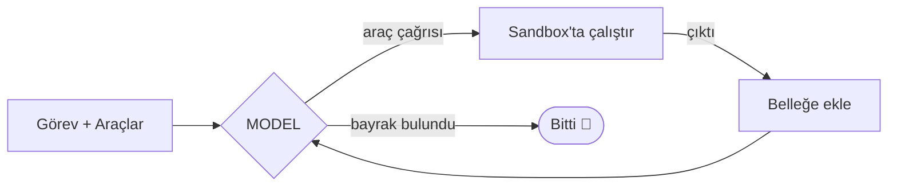

<div align="center">

# 🚩 flaghound

**Öğrenme amaçlı, sıfırdan yazılan otonom bir CTF çözüm ajanı.**

İzole bir sandbox içinde araç çağıran bir LLM döngüsü — her parçası elle, *neden orada olduğu anlaşılarak* yazılır.


</div>

---

## 📖 İçindekiler

- [Hakkında](#-hakkında)
- [Nasıl Çalışır?](#-nasıl-çalışır)
- [Proje Yapısı](#️-proje-yapısı)
- [Kurulum](#-kurulum)
- [Kullanım](#-kullanım)
- [Teknolojiler](#️-teknolojiler)
- [Güvenlik ve Etik](#-güvenlik-ve-etik)
- [Yol Haritası](#️-yol-haritası)
- [Katkıda Bulunma](#-katkıda-bulunma)
- [Lisans](#-lisans)

---

## 🎯 Hakkında

`flaghound`, bir dil modelini (LLM) bir döngünün içine koyarak CTF sorularını otonom çözmeye çalışan küçük bir ajandır. Hazır bir framework kullanmak yerine her bileşen elle yazılır; amaç yalnızca "çalışan bir ajan" değil, **ajan mimarisini içeriden öğrenmektir**: araç çağırma, bağlam yönetimi, döngü kontrolü ve ajanlara özgü güvenlik konuları.

Bu repo bir öğrenme günlüğü gibi ilerler — commit geçmişi, ajanın en basit halinden nasıl olgunlaştığını gösterir.

> [!NOTE]
> Bu proje aktif geliştirilmektedir. Yol haritasından güncel duruma bakabilirsiniz.

### Ne yapar?

- Bir CTF görevini ve kullanabileceği araçları modele tanıtır.
- Model bir araç çağırır (ör. shell komutu), ajan bunu **izole bir Docker konteyneri** içinde çalıştırır.
- Çıktı modele geri verilir; bayrak bulunana ya da adım sınırına gelinene kadar döngü sürer.
- Her adımı okunur biçimde loglar, böylece ajanın karar zinciri takip edilebilir.

---

## 🧠 Nasıl Çalışır?

Bir ajan dört parçadan oluşur: **model** (karar verir), **araçlar** (dış dünyayla etkileşir), **döngü** (ikisini birleştirir) ve **bellek** (bağlamı tutar).



Döngü, bayrak bulunana ya da adım sınırına gelinene kadar döner.

---

## 🗂️ Proje Yapısı

```
flaghound/
├── agent/
│   ├── config.py      # ayarları ve API anahtarını güvenli yükler
│   ├── llm.py         # modele istek atan ince katman
│   ├── tools.py       # ajanın araçları (run_shell, read_file ...)
│   ├── sandbox.py     # komutları Docker içinde izole çalıştırır
│   ├── memory.py      # mesaj geçmişi / bağlam yönetimi
│   └── loop.py        # ana döngü — her şeyi birleştirir
├── prompts/
│   └── system.md      # ajanın sistem talimatı
├── challenges/        # yerel test soruları (arşiv CTF'ler)
├── tests/
└── run.py             # giriş noktası
```

> Dosyalar hepsi birden değil, projede ihtiyaç doğdukça sırayla eklenir.

---

## 🚀 Kurulum

---

## 📄 Lisans

Bu proje [MIT Lisansı](LICENSE) ile lisanslanmıştır.

---

<div align="center">

> [!IMPORTANT]
> Python 3.11 veya üzeri ve Docker kurulu olmalıdır.

```bash
# 1. Repo'yu klonla
git clone https://github.com/<kullanici-adin>/flaghound.git
cd flaghound

# 2. Sanal ortam oluştur ve etkinleştir
python -m venv venv
source venv/bin/activate      # Windows: venv\Scripts\activate

# 3. Bağımlılıkları yükle
pip install -r requirements.txt

# 4. Config dosyasını hazırla
cp .env.example .env
# .env dosyasına API anahtarını gir
```

---

## 💻 Kullanım

```bash
python run.py --challenge challenges/example
```

| Argüman | Açıklama | Varsayılan |
|---------|----------|------------|
| `--challenge` | Çözülecek görevin klasör yolu | — |
| `--max-steps` | Ajanın deneyeceği azami adım sayısı | `20` |
| `--verbose` | Her adımı ayrıntılı logla | `false` |

---

## ⚙️ Teknolojiler

| Katman | Seçim | Neden |
|--------|-------|-------|
| Dil | Python 3.11+ | Güvenlik ekosisteminin ortak dili |
| Model | Tool-use destekli LLM API'si | Araç çağırma ajanın temeli |
| İzolasyon | Docker | Komutları host'tan ayırır |
| Config | `.env` + `pydantic-settings` | Anahtarı koddan ayırır |
| Log | `rich` | Okunur, renkli çıktı |
| Test | `pytest` | İlerlemeyi ölçer |

---

## 🔐 Güvenlik ve Etik

Bu ajan **gerçek komutlar çalıştırır**. Sorumlu kullanım şarttır.

> [!WARNING]
> Ajanı **yalnızca** kendi lab ortamında, resmi CTF platformlarında veya açıkça izin verilmiş hedeflere karşı çalıştır. Yetkisiz sistemlere yönelik kullanım yasa dışıdır.

- Komutlar her zaman **izole bir konteyner/VM** içinde çalışmalı, host makineye erişmemeli.
- Başlangıçta ağ erişimini kıs; sadece hedef servise izin ver.
- `.env` dosyasını **asla** commit'leme (zaten `.gitignore`'da).

---

## 🗺️ Yol Haritası

- [x] Proje tanıtımı ve README
- [ ] Config ve güvenli anahtar yükleme
- [ ] Model ile ilk bağlantı (`llm.py`)
- [ ] İlk araç: izole `run_shell`
- [ ] Ana döngü (`loop.py`)
- [ ] Yerel soruyla uçtan uca ilk çözüm
- [ ] Bağlam özetleme / kırpma
- [ ] Basit eval: "kaç soruyu çözdü" ölçümü
- [ ] Çoklu araç (decompile, ağ bağlantısı, dosya analizi)

---

## 📄 Lisans

Bu proje [MIT Lisansı](LICENSE) ile lisanslanmıştır.

---

<div align="center">
<sub>Bir öğrenme yolculuğu olarak inşa ediliyor. 🚩</sub>
</div>